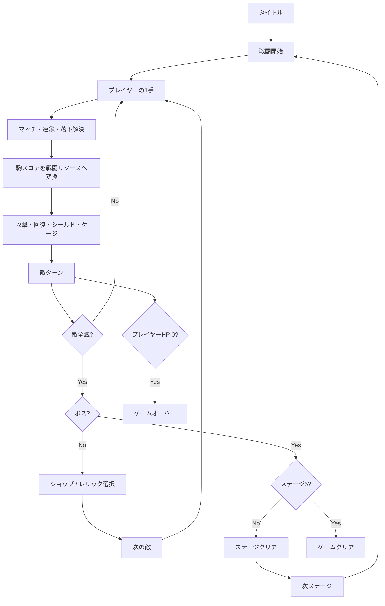

# 3Dゲーム移植用 ゲームシステム仕様・実装ガイド（現行実装準拠）

本資料は、本作（Godot 4.4 / GDScript の 2D パズル RPG）のゲームシステムを別の 3D ゲームへ移植するための仕様書兼実装ガイドである。

- **正とする情報**: リポジトリ内の現行 GDScript 実装（`puzzle_board.gd`、`score_manager.gd`、`stage_manager.gd`、`relic_database.gd`、`relic_manager.gd`、`element_data.gd` など）
- **対象範囲**: 盤面、駒、属性、マッチ・コンボ、特殊駒、スキル、進化、ショップ、レリック、フィーバー、敵、戦闘、UI、起動処理、セーブ設計
- **移植方針**: 2D の座標・ノード構成・演出をそのまま持ち込まず、**論理モデル（盤面・戦闘・進行）と 3D 表示層を分離**して再実装する

> **重要**: 本資料は「現行コードで実際に動く内容」を基準にしている。`SpecialItemType` には互換用の未使用 ID が残っているが、通常プレイで生成できないものは仕様に含めない。特に **ジェミニボムは現行仕様では未実装**（解禁スキル・生成経路なし）である。

---

## 目次

1. [全体像とアーキテクチャ](#1-全体像とアーキテクチャ)
2. [ゲーム進行とコアループ](#2-ゲーム進行とコアループ)
3. [盤面システム](#3-盤面システム)
4. [属性システム](#4-属性システム)
5. [スコア・通貨・戦闘リソース](#5-スコア通貨戦闘リソース)
6. [スキルツリーと進化](#6-スキルツリーと進化)
7. [ショップと経済](#7-ショップと経済)
8. [レリック](#8-レリック)
9. [フィーバータイム](#9-フィーバータイム)
10. [敵・ステージ・戦闘AI](#10-敵ステージ戦闘ai)
11. [状態異常・盤面効果](#11-状態異常盤面効果)
12. [UI・ツールチップ・用語辞書](#12-uiツールチップ用語辞書)
13. [起動処理・音声・パフォーマンス](#13-起動処理音声パフォーマンス)
14. [3Dゲームへのマッピング](#14-3dゲームへのマッピング)
15. [データ設計案](#15-データ設計案)
16. [処理フロー擬似コード](#16-処理フロー擬似コード)
17. [移植時の注意点・受け入れテスト](#17-移植時の注意点受け入れテスト)

---

## 1. 全体像とアーキテクチャ

### 1.1 ゲームの要約

- **ジャンル**: 13×13 のマッチ3パズル + ターン制バトル + ローグライト（スキルツリー / レリック / ショップ）
- **1ターンの流れ**: プレイヤーが駒を1回スワップ → マッチ・連鎖・落下を解決 → 消した駒のスコアが攻撃・回復・シールド・ゲージ・通貨へ変換 → 敵が意図に沿って行動 → 次ターン
- **勝利条件**: 各ステージの敵を全滅させる。ステージ5のボス撃破でクリア
- **敗北条件**: プレイヤー HP が 0 になる
- **成長要素**: 10属性のスキルツリー、属性カテゴリー選択、レリック、ショップの恒久強化

### 1.2 レイヤ構成（移植先で推奨する分離）

```text
┌─────────────────────────────────────────────┐
│ Presentation / 3D View                      │
│  - 盤面メッシュ、駒モデル、カメラ、VFX        │
│  - 入力レイキャスト、選択・スワップ予測表示     │
│  - HUD / ツールチップ / バナー                 │
├─────────────────────────────────────────────┤
│ Game Logic                                  │
│  - BoardModel（13×13 の論理グリッド）          │
│  - MatchResolver / CascadeResolver            │
│  - TurnController / BattleResolver            │
│  - SkillSystem / RelicSystem / FeverSystem    │
├─────────────────────────────────────────────┤
│ Data                                        │
│  - PieceDef / ElementDef / SkillDef           │
│  - RelicDef / EnemyDef / StageDef             │
│  - SpecialDef / EvolutionDef / ShopDef        │
├─────────────────────────────────────────────┤
│ Save / Progression                          │
│  - RunState（HP、通貨、スキルLv、レリック）    │
│  - MetaState（解放状況、設定）                 │
└─────────────────────────────────────────────┘
```

**重要**: 現行実装は `PuzzleBoard` が盤面ロジックと 2D 演出の両方を持っている。3D 移植では、`PuzzleBoard` に相当するロジックを **Godot の Node から独立した純粋クラス**（またはシーン非依存のサービス）へ切り出し、3D 側はその状態を読んで表示するだけにする。これにより、テスト・サーバー検証・リプレイ・セーブが容易になる。

### 1.3 現行シーンのノード構成

`current_stage.tscn` の主要ノード:

| ノード | 役割 |
|---|---|
| `CurrentStage` | 戦闘シーン全体。`RelicManager` / `RelicUIManager` を動的生成 |
| `PuzzleBoard` | 13×13 盤面、マッチ、落下、駒、属性マス、スキル発動、投射物 |
| `ScoreManager` | スコア、通貨、HP バー、フィーバー UI、コンボ、ショップ、スキルツリー |
| `StageManager` | 敵生成、ターン進行、敵意図、フィーバー、ステージクリア、勝利演出 |
| `BuffManager` | ショップ強化の補助 |
| `RelicManager` | レリック所持・強化・効果フック（動的生成） |
| `RelicUIManager` | スキルバー、レリックバー、ツールチップ（動的生成） |

3D 側では、これらを 1 つのシーンに詰め込まず、**盤面・戦闘・UI・進行のサービスを分離**する。

### 1.4 主要ファイルと責務

| ファイル | 責務 | 移植先での対応 |
|---|---|---|
| `puzzle_board.gd` | 盤面、マッチ、コンボ、特殊駒、属性マス、スキル発動、投射物 | `BoardModel` + `MatchResolver` + `SkillExecutor` + `BattleView` |
| `score_manager.gd` | スコア、通貨、スキルツリー、進化、ショップ、UI 更新 | `ProgressionService` + `EconomyService` + `SkillTreeService` |
| `stage_manager.gd` | 敵生成、ステージ、ターン、フィーバー、敵意図、勝敗 | `StageService` + `EnemyAI` + `FeverService` |
| `relic_database.gd` | レリック定義、レアリティ、説明文 | `RelicDef` データ |
| `relic_manager.gd` | レリック所持・強化・効果フック・シリアライズ | `RelicService` |
| `relic_selection_ui.gd` | レリック抽選、属性カテゴリー絞り込み | `RelicRewardService` + UI |
| `element_data.gd` | 10属性、色、相性倍率 | `ElementDef` データ + `ElementRules` |
| `glossary_database.gd` | 用語辞書、ホバー解説 | `GlossaryService` |
| `current_stage.gd` | シーン初期化、RelicManager 生成、設定ボタン | `BattleSceneBootstrap` |
| `title_screen.gd` | タイトル、非同期シーンロード | `StartupController` |

---

## 2. ゲーム進行とコアループ

### 2.1 全体フロー



### 2.2 ステージ進行

- 全 **5ステージ**。
- 各ステージは複数の敵戦で構成される。`stage_enemy` が 1〜5 の戦闘番号。
- **ステージ1**: 出現数は常に **1体**。戦闘番号に応じて敵の強さが段階的に上昇。
- **ステージ2以降**: 通常戦は **1〜3体**、ボス戦は **1体**。
- **ボス**: `stage_enemy == 5` または `spawn_as_boss` で出現。ステージ5のボスはラスボス。
- 敵撃破後、`stage_enemy` が `RELIC_OFFER_BATTLE_INDICES = [1,2,3,4,5]` に含まれる場合、レリック選択を挟む。属性カテゴリー未選択なら最初の撃破後に **3カテゴリーから1つ必須選択**。
- ステージクリア後は次ステージへ。HP は持ち越し（ステージ進行で自動全回復しない）。

### 2.3 ターンの状態機械

現行の `BoardState`:

| 状態 | 意味 |
|---|---|
| `IDLE` | プレイヤー入力待ち |
| `SWAPPING` | 駒のスワップ移動中 |
| `MATCH_HIGHLIGHT` | マッチ強調演出中（コンボ数 +1） |
| `BREAKING` | 駒の縮小・消滅演出中（スコア確定） |
| `FALLING` | 重力落下中 |
| `CASCADE_CHECK` | 落下後の連鎖判定 |
| `TURN_SEQUENCE` | 戦闘・敵ターン演出 |

**移植の要点**: この状態機械は「入力受付の可否」と「演出の完了待ち」を管理する。3D 側でも同じ状態を持ち、**ロジックの解決と表示アニメーションを分離**する。表示アニメーションが終わったら `await` で次状態へ進むのではなく、ロジック側は即座に確定し、表示側がキューを消化する設計が望ましい。

### 2.4 1ターンの詳細シーケンス

1. プレイヤーが隣接する2駒をスワップ、または特殊駒をクリック。
2. スワップ後にマッチが成立するか判定。成立しなければ元に戻し、ターン消費なし。
3. マッチ成立時:
   - コンボ数 +1。
   - 特殊駒生成判定（同種4個以上。対応スキル解禁時のみ）。
   - マッチ強調 → 消滅 → スコア計算 → 落下 → 連鎖判定。
4. 連鎖が続くたびにコンボ数 +1、スコア倍率上昇。
5. 盤面が安定したら、消した駒の累積スコアを戦闘リソースへ変換:
   - 剣 → 敵への攻撃
   - 食料 → HP 回復
   - 盾 → シールド
   - ポーション → フィーバーゲージ（一部はスキル購入用に残る）
   - コイン → 通貨
6. 敵の意図を決定し、敵ターン演出。
7. 敵の攻撃・スキル解決。
8. ターン終了処理（状態異常、植物、霧、フィーバーターン消費など）。
9. `IDLE` に戻る。

### 2.5 入力

- マウスのドラッグ or クリックで駒を選択し、隣接方向へスワップ。
- 特殊駒はクリックで即起爆（1手消費）。
- スキルボタンは、スキル Lv > 0 かつ MP が足りるときのみ発動。
- フィーバー突入演出中は盤面入力・スキル発動を遮断する。
- ゲームオーバー時は全入力を遮断する。

---

## 3. 盤面システム

### 3.1 基本パラメータ

| 項目 | 値 |
|---|---|
| 列数 | 13 |
| 行数 | 13 |
| 駒の種類 | 5 |
| マッチ成立 | 同種 3個以上（縦 or 横） |
| 初期盤面 | マッチが成立しないように生成 |
| 盤面外 | 駒は落下不能。壁として扱う |

現行の 2D 表示では `CELL_PITCH = 700`、`BOARD_LEFT = 2550`、`BOARD_TOP = 220` などの巨大座標を使っているが、**これは表示専用**。3D 側では 1 マス = 1 論理セルとして扱い、表示スケールは別途決める。

### 3.2 駒（PieceType）

| ID | 名前 | 役割 | 消去時の主な変換先 |
|---|---|---|---|
| 0 | SHIELD（盾） | 防御 | シールド |
| 1 | SWORD（剣） | 攻撃 | 敵ダメージ |
| 2 | COIN（コイン） | 通貨 | コイン（ショップ用） |
| 3 | POTION（ポーション） | スキル資源・フィーバー | フィーバーゲージ + スキル購入通貨 |
| 4 | FOOD（食料） | 回復 | HP 回復 |

**駒の種類と属性は別レイヤ**。駒は「形（役割）」、属性は「盤面マスに付与される元素」である。1つの駒が水マス上にある、といった重なりを許容する。

### 3.3 論理グリッドの持ち方

現行実装は複数の 13×13 配列で盤面を表現している。3D 移植でも同じ分離を推奨する。

| 配列 | 内容 |
|---|---|
| `grid_n[r][c]` | 駒の種類（0〜4、-1 は空） |
| `grid_att[r][c]` | 駒の表示属性（0〜4 の循環） |
| `grid_element[r][c]` | 元素属性（Element enum、0 = なし） |
| `special_item[r][c]` | 特殊駒の種類 |
| `special_charge[r][c]` | チャージ系特殊駒の段階 |
| `grid_water[r][c]` | 水マス |
| `grid_fire[r][c]` | 火マス（残り寿命ターン数） |
| `grid_ice[r][c]` | 氷マス（耐久値） |
| `grid_poison[r][c]` / `grid_poison_stage[r][c]` | 毒マス / 毒の段階 |
| `grid_stones[r][c]` | 石マス（耐久値） |
| `grid_gold_statue[r][c]` | 黄金像（耐久値） |
| `grid_electrified[r][c]` | 帯電マス |
| `grid_cursed[r][c]` | 呪いマス |
| `grid_fog` | 黒い霧（矩形と残りターン） |
| `plant_entities` | 植物（苗木・若木・大木）のリスト |
| `*_ally` 系 | そのマスが味方由来かどうか |

**3D 移植の推奨**: これらを 1 つの `Cell` 構造体にまとめる。

```text
Cell {
  piece: PieceType | null
  element: Element
  special: SpecialType
  specialCharge: int
  hazard: { water, fireTurns, iceHp, poisonStage, stoneHp, goldHp, electrified, cursed }
  owner: Ally | Enemy | Neutral
  plant: PlantRef | null
  fog: FogRef | null
}
```

### 3.4 マッチ判定

- 横方向・縦方向に同種の駒が **3個以上** 連続したらマッチ。
- 石・黄金像・植物・特殊駒はマッチ対象外（障害物として扱う）。
- **敵所有**の水マス・氷マス・石マス・黄金像マスはスワップ不可。味方所有のものはスワップ可能。
- マッチしたセルは `ismatched[r][c] = true` で記録。
- 交差（L字・T字）は「横セグメント」と「縦セグメント」の連結成分としてグループ化し、1つのマッチグループとして扱う。

### 3.5 コンボと連鎖

- マッチが成立するたびに `combocount` を +1。
- コンボ倍率: `1.0 + (combocount - 1) * 0.25`
  - 1コンボ: ×1.00
  - 2コンボ: ×1.25
  - 3コンボ: ×1.50
  - 4コンボ: ×1.75
- ターン開始時に `combocount = 0`。
- 連鎖中はコンボ案内役・矢印・「COMBO N!」を表示する。
- コンボ数はスコアだけでなく、一部のレリック・スキル（風の「疾風怒濤」など）の条件にも使う。

### 3.6 落下と補充

- マッチ消去後、上にある駒が下へ落ちる。
- 空いた上部から新しい駒が補充される。
- 落下後に再度マッチ判定（連鎖）。
- 連鎖が止まるまで `FALLING → CASCADE_CHECK → MATCH_HIGHLIGHT → BREAKING` を繰り返す。
- 落下中も盤面の論理状態は確定させ、表示は補間する。

### 3.7 特殊駒（スキル駒）

**現行仕様の重要点**:

- 特殊駒は **同種の駒を4個以上消したとき**、選択カテゴリーと対応スキルの Lv に応じて生成される。
- 対応スキルが Lv0 の場合は生成されない。
- 落下時のランダム湧きは廃止されている（`_roll_falling_special()` は常に `NONE`）。
- 1つのマッチグループにつき最大1個。生成位置は「交差点 → 最後にスワップしたセル → 最長セグメントの中央」の優先順。
- 特殊駒のレベルは、対応するスキルのレベルと同じ。

| 特殊駒 | Enum | 解禁スキル | 主な生成条件 | 現行効果 |
|---|---|---|---|---|
| フレイムボム（演出名: ブレイズブラスト） | `BOMB` = 1 | 火 `fire_1` | 剣を4個以上 | 火マスを `3 + (Lv-1)/2` 個生成（中心→隣接→ランダム）。火の寿命は `3 + (Lv-1)/3` ターン。着火マスの駒を消去し、敵に `(80 + Lv×20) × ステージ倍率` ダメージ |
| ライトニング | `LIGHTNING` = 5 | 雷 `thunder_1` | コインを4個以上 | ランダムな `3 + int(Lv×1.1)` マスへ落雷。石への耐久ダメージ `2 + (Lv-1)/3`。水マスへ感電伝播 |
| チャージボム | `CHARGE_BOMB` = 11 | 地 `earth_1` | シールドを4個以上 | 毎ターン開始時にチャージ段階が最大3まで上昇。半径 `チャージ + (Lv-1)/5` を爆破。石への耐久ダメージ `チャージ + (Lv-1)/3`。敵に `(150 + Lv×35) × チャージ × ステージ倍率` ダメージ |
| アクアスプラッシュ | `AQUA_SPLASH` = 8 | 水 `water_1` | ポーションを4個以上 | 半径1（Lv1〜2）/ 半径2（Lv3〜7）/ 半径3（Lv8〜13）/ 半径5（Lv14〜）の円形に水マスを生成し、範囲内の駒を消去。植物が即座に吸水 |
| 生命の苗木 | `TREE_SPROUT` = 9 | 木 `wood_1` | 食料を4個以上 | 苗木を植える。Lv5〜11は若木から、Lv12以上は3×3の大木から開始。雷耐久は `1 + (Lv-1)/3`。設置時に水を吸収 |
| トルネード | `TORNADO` = 7 | 風 `wind_1` | コインを4個以上 | 縦列を薙ぎ払う。幅はLv1=1マス、Lv2〜6=3マス、Lv7以上=5マス。列上の水・火・毒・呪い・帯電を消去。通常駒は「突風」進化所持時のみ巻き込む。植物・石にダメージ |
| ポイズンミスト | `POISON_MIST` = 14 | 毒 `poison_1` | ポーションを4個以上 | 半径1（Lv1〜5）/ 半径2（Lv6〜13）/ 半径3（Lv14〜）に毒マスを展開。敵に `(90 + Lv×20) × ステージ倍率` ダメージ。範囲内の特殊駒を誘爆 |
| ホーリースター | `HOLY_LIGHT` = 10 | 光 `light_1` | コインを4個以上 | 聖像を `2 + (Lv-1)/3` 体生成。敵の毒・火・呪い・氷を全浄化。敵に `(70 + Lv×15) × ステージ倍率` ダメージ。最終進化で聖像共振 |
| ブラックホール | `BLACK_HOLE` = 6 | 闇 `dark_1` | 剣を4個以上 | 半径1（Lv1）/ 半径2（Lv2〜6）/ 半径3（Lv7〜12）/ 半径4（Lv13〜）の範囲の駒を吸引消去。石への耐久ダメージ `1 + (Lv-1)/3`。影護マスを `2 + Lv/2` 個生成 |
| 氷晶 | `ICE_SHIELD` = 13 | 氷 `ice_1` | シールドを4個以上 | 起爆時に氷スキルを発動。Lv1〜4はTier1、Lv5〜9はTier2、Lv10以上はTier3相当 |
| スターオーブ | `DISCO_BALL` = 3 | 光最終進化C2「昇天の像」 | 味方の聖像を消去した時 | 起爆時はホーリースターと同じ処理（`_trigger_holy_light`）。単独の解禁スキルは存在しない |

> **レベル参照**: 上記の特殊駒は対応スキルのレベルを参照する。`DISCO_BALL`（スターオーブ）だけは例外で、生成元の `light_final_c2` を持っていれば `light_1` のレベルでホーリースター処理を行う。

> **未使用・未実装の互換ID**: `CROSS_BOMB`（2）、`COLOR_CONVERTER`（4）、`GEMINI_BOMB`（12）は enum と起爆関数が残っているが、これらを解禁するスキル・生成経路が現行のスキルツリーに存在しない。特に **ジェミニボムは未実装**として扱う。`MAGNET`（10）は `HOLY_LIGHT` の互換エイリアス。

### 3.8 属性マス・障害物

| マス | 挙動 |
|---|---|
| 水マス | 敵所有はスワップ不可。水スキル・アクアスプラッシュで生成。ターン終了時の水進化効果、雷の感電拡散、植物の吸水対象 |
| 火マス | 毎ターン隣接マスへ1つ延焼。寿命が0になると消滅し、そのマスの駒も消去。水と接触すると相殺 |
| 氷マス | 敵所有はスワップ不可。耐久値を持ち、マッチや雷で減少。炎で融解、雷で破砕。隣接する敵効果マスの進行を抑制 |
| 毒マス | ターン終了時に毒ダメージ。段階を持ち、隣接マスへ侵食。毒スキル・ポイズンミストで生成 |
| 石マス | 耐久値を持つ障害物。敵所有はスワップ不可、味方所有は移動可。雷・地スキルで破砕 |
| 黄金像 | 耐久値を持つ像。破壊時に +500 スコア（光最終進化A1では +1000）。味方の聖像は破壊時に光ダメージも発生。光スキルで生成 |
| 帯電マス | 雷スキルで付与。触れる・マッチ・放電の起点 |
| 呪いマス | 敵所有は消去時に反動ダメージ。味方所有（影護マス）は消去時に吸収回復。闇スキルで生成 |
| 黒い霧 | 毎ターン範囲内に継続ダメージ（敵霧→プレイヤー、味方霧→敵）。ターン経過で消滅。**マッチ自体は禁止しない** |
| 植物 | 苗木 → 若木 → 大木（3×3）。水を吸って成長。火で延焼、雷に耐久値。大木はターン終了時に回復・収穫効果 |

### 3.9 属性シナジー

| 組み合わせ | 効果 |
|---|---|
| 水 + 火 | 互いに消滅（相殺） |
| 氷 + 火 | 氷が水に変化 |
| 雷 + 水 | 感電が水上全体へ拡散 |
| 雷 + 石/氷 | 粉砕（シャッター）して周囲 3×3 を巻き込む |
| 木 + 水 | 植物が吸水して成長 |
| 木 + 火 | 大延焼 |
| 光 + 闇/毒 | 浄化・追加ダメージ |

---

## 4. 属性システム

### 4.1 10属性

| Enum | キー | 日本語 | 色 |
|---|---|---|---|
| 1 | fire | 火 | `#FF6633` 系 |
| 2 | water | 水 | `#4D99FF` 系 |
| 3 | wind | 風 | `#66E666` 系 |
| 4 | thunder | 雷 | `#E6E633` 系 |
| 5 | light | 光 | `#FFE699` 系 |
| 6 | dark | 闇 | `#B34DE6` 系 |
| 7 | poison | 毒 | `#AB47BC` 系 |
| 8 | ice | 氷 | `#80D8FF` 系 |
| 9 | wood | 木 | `#4DD966` 系 |
| 10 | earth | 地 | `#D9A659` 系 |
| 0 | none | 無 | 透明 |

### 4.2 3カテゴリー

| カテゴリー | キー | 属性 | 役割 |
|---|---|---|---|
| 自然・生命 | `nature` | 水・氷・木・風 | 回復、凍結防御、浄化、成長 |
| 元素・破壊 | `force` | 火・雷・地 | 爆発、落雷、岩盤破砕、瞬間火力 |
| 神秘・冥術 | `mystic` | 毒・光・闇 | 毒、聖光、重力、呪い |

カテゴリー選択は最初の敵撃破後に **必須**。選択すると、そのカテゴリーのスキルがショップで解放可能になり、該当属性の与ダメージ +30% のレリックを得る。他カテゴリーの専門レリックは抽選候補から除外される。

### 4.3 属性相性

`get_damage_multiplier(attack, defense)` の実装:

| 攻撃属性 | 有利（×1.5） | 不利（×0.5） |
|---|---|---|
| 火 | 風、毒 | 水 |
| 水 | 火 | 雷、毒 |
| 風 | 雷 | 火、毒 |
| 雷 | 水 | 風 |
| 光 | 闇、毒 | - |
| 闇 | 光 | - |
| 毒 | 水、風 | 火、光 |

それ以外は ×1.0。無属性は常に ×1.0。

> **注意**: 現行の敵属性文字列パーサは「氷」を WATER、「地」を WIND に丸めている。3D 移植では日本語文字列を解析せず、**属性 ID を明示的に持つ**こと。

---

## 5. スコア・通貨・戦闘リソース

### 5.1 5種類の蓄積値（divscore）

駒を消すと、駒の種類ごとに「スコア」が蓄積される。これがそのまま戦闘リソースになる。

| 駒 | 蓄積先 | 戦闘での使われ方 |
|---|---|---|
| 盾 | `divscore[SHIELD]` | シールド（敵ダメージを肩代わり） |
| 剣 | `divscore[SWORD]` | 敵へのダメージ |
| コイン | `divscore[COIN]` | ショップ通貨 |
| ポーション | `divscore[POTION]` | フィーバーゲージ + スキル購入通貨 |
| 食料 | `divscore[FOOD]` | HP 回復 |

### 5.2 スコア計算式

マッチした連結成分ごとに計算する。

```text
count       = 連結成分のセル数
base_score  = max(count * 100, count * (count - 2) * 100)
bonus_add   = stat_levels[pieceType] * 100 * count
mult        = pieceMultiplier[pieceType]   // 現行は 1.0
combo_mult  = 1.0 + max(0, combocount - 1) * 0.25
earned      = max(100 * count,
                  int((int(base_score * mult) + bonus_add) * combo_mult))
totalScore += earned
```

- `stat_levels` はショップの「獲得スコア強化」レベル。
- フィーバー中は、**総スコア `totalScore` ではなく、`divscore` へ加算する量**に追加倍率がかかる。
- スコア表示は 5 列（駒の種類ごと）に分かれる。

### 5.3 戦闘リソースへの変換

ターン終了時、盤面が安定してから蓄積値を消費して戦闘処理を行う。

#### 剣 → ダメージ

```text
rawCount   = min(enemyHP / swordt, divscore[SWORD] / (swordt * 100))
damageEach = 100 * swordt
total      = rawCount * damageEach   // 端数は投射物に配分
```

実質的に **蓄積した剣スコアがそのまま総ダメージ**になる。投射物数は演出用に最大 24 個へ制限し、1個あたりのダメージに配分する。

#### 食料 → 回復

```text
healUnit = max(1, foodt * 100)
count    = min(必要回復量 / healUnit, divscore[FOOD] / healUnit)
totalHeal = count * 100
```

回復は最大 HP を超えない。

#### 盾 → シールド

```text
shieldCount = divscore[SHIELD] / (shieldt * 100)
```

敵攻撃時、シールドは以下の式でダメージを肩代わりする。

```text
blockedPerShield = (attack - attack / (shieldCount + 1)) / shieldCount
capacity         = shieldCount * blockedPerShield / elementMultiplier
blocked          = min(remainingAttack, capacity)
```

属性相性が悪いシールドから先に消費される。シールドは原則ターン終了時に消滅する（氷の中間進化「持ち越し」がある場合は蓄積）。

#### ポーション → フィーバーゲージ

```text
maxGaugeCount = 70 - floor(feverGauge / (100 * potiont))
count         = min(maxGaugeCount, divscore[POTION] / (potiont * 100))
gaugeGain     = count * 100
consumeScore  = count * potiont * 50
```

- ゲージ上限は **7000**。
- 1個あたり **+100**。
- 1ターンに最大 **70個** までゲージへ変換。
- ゲージへ回すとポーションスコアの **50%** が消費され、残りはスキル購入用に保持される。

#### コイン → 通貨

`divscore[COIN]` がそのままショップ通貨。レリックの `modify_coin_gain` で増減する。

### 5.4 プレイヤー HP

- 初期最大 HP: **5000**
- 初期 HP: **5000**
- ショップの最大 HP 強化: **+2500 × ステージ倍率**（`10^(stage-1)`）
- ステージ進行では自動回復しない
- HP が 0 以下でゲームオーバー

### 5.5 スキル用 MP

| 項目 | 値 |
|---|---|
| 最大 MP | 100 |
| 初期 MP | 100 |
| マッチ1セルあたり回復 | +5 |
| ターン開始時回復 | +25 |
| 光「共鳴の像」など | 聖像消去時に +20 |
| スキルコスト | Tier1: 30 / Tier2: 45 / Tier3: 60 |
| 軽減レリック | `elemental_affinity_ring`（同カテゴリー -30%）、`superconduct_ring`（雷 -30%） |

MP はマッチで回復するため、スキルは「盤面を消すほど使える」設計。

---

## 6. スキルツリーと進化

### 6.1 基本構造

- **10属性 × 基本スキル1本**（`water_1` 〜 `dark_1`）
- 各スキルは **Lv0〜20**
- Lv0 は未習得。Lv1 以上でスキル発動可能。
- 購入には **ポーション通貨** を使う。
- 初期コスト **1000**、購入ごとに **×1.55**。
- 属性カテゴリーを選択すると、そのカテゴリーのスキルが購入可能になる。

### 6.2 スキル一覧（基本形）

| 属性 | ID | 名前 | 対応する特殊駒（`sp_type`） | 役割 |
|---|---|---|---|---|
| 水 | `water_1` | 清流展開 | `AQUA_SPLASH`（8） | 水マス生成・駒消去・回復系進化 |
| 氷 | `ice_1` | 氷盾付与 | `ICE_SHIELD`（13） | 氷マス・シールド・敵行動停止 |
| 木 | `wood_1` | 命の萌芽 | `TREE_SPROUT`（9） | 植物・成長・吸収 |
| 風 | `wind_1` | 疾風突風 | `TORNADO`（7） | 竜巻・列操作 |
| 火 | `fire_1` | 紅蓮爆破 | `BOMB`（1） | 火マス・延焼・爆発 |
| 雷 | `thunder_1` | 雷電連鎖 | `LIGHTNING`（5） | 落雷・感電 |
| 地 | `earth_1` | 岩盤崩落 | `CHARGE_BOMB`（11） | 石・シールド・震撃 |
| 毒 | `poison_1` | 瘴気毒霧 | `POISON_MIST`（14） | 毒マス・拡散 |
| 光 | `light_1` | 聖像降臨 | `HOLY_LIGHT`（10） | 聖像・回復・浄化 |
| 闇 | `dark_1` | 星影の帳 | `BLACK_HOLE`（6） | 黒穴・呪い・重力 |

### 6.3 進化

- **Lv10**: 中間進化。**3分岐**から1つ選択。
- **Lv20**: 最終進化。Lv10 で選んだ中間進化ごとに **2択**。
- 進化は購入時にモーダルで選択。未選択のまま Lv を上げることはできない。
- 進化 ID は `skill_evolutions[skill_id]["mid" / "final"]` に保存。
- 進化特性は `has_skill_trait(skill_id, evo_id)` で判定し、盤面処理・ダメージ・回復などにフックする。

#### 進化の例（水）

| 中間進化 | 効果 | 最終進化の例 |
|---|---|---|
| 生命の清流 | ターン終了時、水マス1個につき `20 + Lv×5` 回復 | 癒しの雨 / 溢れる泉 |
| 水華の防壁 | ターン終了時、水マス1個につき `30 + Lv×8` シールド | 水鏡 / 水の結界 |
| 激流の怒涛 | ターン終了時、水マス1個につき `50 + Lv×12` 水サージ | 水撃 / 渦潮 |

> 全10属性分の進化定義は `score_manager.gd` の `SKILL_EVOLUTION_REGISTRY` にある。移植時はこの辞書をそのままデータ化する。

### 6.4 盤面スキル（アクティブ）

スキルツリーとは別に、MP を消費して発動する **盤面スキル** がある。

- スキルごとに **Tier1 / Tier2 / Tier3**。
- Tier は UI で切り替え可能。
- 発動条件: スキル Lv > 0、MP がコスト以上、盤面が `IDLE`、敵ターン中でない。
- 発動すると盤面に属性マスを生成したり、駒を変換・消去したり、直接ダメージを与える。
- 直接ダメージは `RelicManager.modify_damage_dealt()` を通してから適用される。

#### 属性別の代表効果（現行の主な数式）

| 属性 | Tier1 | Tier2 | Tier3 |
|---|---|---|---|
| 水 | 水マス `2 + Lv/2` 個生成＋駒消去。ダメージ `(80 + Lv×15) × ステージ倍率` | 水マス1個につき `150 + Lv×30` 回復。浸水拡大 `2 + Lv/3` マス。ダメージ `(130 + Lv×25)` | 水マス上の駒を剣に変換。ダメージ `(260 + Lv×55) × (1 + Lv×0.2) × ステージ倍率` |
| 氷 | 氷マス `2 + Lv/2` 個生成（耐久3）。ダメージ `(80 + Lv×15)` | 水・毒・敵火を最大 `2 + Lv/2` マス凍結（耐久3）。ダメージ `(140 + Lv×25)` | 全氷マスを共鳴爆砕＋敵行動停止。ダメージ `氷マス数 × (240 + Lv×60)` |
| 木 | 苗木を1本植樹。ダメージ `(60 + Lv×12)` | 味方植物を1段階成長。ダメージ `(120 + Lv×25)` | 3×3の大木を (3,3) に生成。ダメージ `(250 + Lv×50)` |
| 風 | 竜巻で縦列を掃射。幅 `1 + Lv/3` 列。ダメージ `(80 + Lv×15)`（通常駒消去は「突風」進化時のみ） | 自軍の火・水マスを風下（右）へシフト。ダメージ `(140 + Lv×25)` | 敵所有の効果マスを自軍へ反転。ダメージ `max(1, 反転数) × (70 + Lv×20)` |
| 火 | 火マス2個＋駒消去。寿命3。ダメージ `(100 + Lv×20)` | 火マス4個＋駒消去。寿命4。ダメージ `(180 + Lv×35)` | 火マス6個＋駒消去。寿命5。ダメージ `(320 + Lv×60)` |
| 雷 | 帯電マス `2 + Lv/2` 個生成＋1列落雷。ダメージ `(90 + Lv×18)` | 帯電・水マスを一斉感電。ダメージ `ノード数 × (120 + Lv×30)` | 全帯電・石・氷を一斉3×3爆砕。ダメージ `(破砕数 + 1) × (280 + Lv×60)` |
| 地 | 石マス `2 + Lv/3` 個生成（耐久2、進化で3）。シールド `150 + Lv×30`。ダメージ `(80 + Lv×15)` | 全石の耐久を1削り周囲を震撃。ダメージ `max(1, 石数) × (110 + Lv×25)` | 全石を一斉粉砕。ダメージ `(破砕数 + 1) × (260 + Lv×55)` |
| 毒 | 毒マス `2 + Lv/2` 個生成。ダメージ `(80 + Lv×15)` | 毒を即時伝染。ダメージ `毒マス数 × (60 + Lv×15)` | 全毒マス起爆。ダメージ `max(1, 毒マス数) × (220 + Lv×50)`、30% HP吸収 |
| 光 | 聖像 `2 + Lv/2` 体生成（耐久2）。シールド `80 + Lv×15`。ダメージ `(100 + Lv×20)` | 聖像間の妨害マスを浄化。ダメージ `(130 + Lv×25)` | 全聖像を消費して聖剣レーザー。ダメージ `(聖像数 + 1) × (260 + Lv×55)` |
| 闇 | 2×2の暗雲を3ターン生成＋影護マス `2 + Lv/2` 個生成。ダメージ `(80 + Lv×15)` | 暗雲領域を影護マスへ侵食。ダメージ `暗雲マス数 × (50 + Lv×15)` と同量回復 | 全影護マスを吸引消滅＋50% HP吸収。ダメージ `max(1, 影護数) × (240 + Lv×50)` |

**実装上の注意**: 現行コードでは各 Tier の効果が巨大な `match` 文で書かれている。3D 移植では、`SkillEffect` をデータ駆動（効果のリスト）に分解し、`SkillExecutor` が順に適用する形が望ましい。

### 6.5 スキルと特殊駒の関係

特殊駒の生成可否は、選択カテゴリーとスキルレベルに依存する。対応スキルが Lv0 の場合は生成されない。

| カテゴリー | 消す駒 | 解禁スキル | 生成される特殊駒 |
|---|---|---|---|
| `nature` | ポーション | `water_1` | `AQUA_SPLASH` |
| `nature` | シールド | `ice_1` | `ICE_SHIELD` |
| `nature` | 食料 | `wood_1` | `TREE_SPROUT` |
| `nature` | コイン | `wind_1` | `TORNADO` |
| `force` | 剣 | `fire_1` | `BOMB` |
| `force` | コイン | `thunder_1` | `LIGHTNING` |
| `force` | シールド | `earth_1` | `CHARGE_BOMB` |
| `mystic` | ポーション | `poison_1` | `POISON_MIST` |
| `mystic` | コイン | `light_1` | `HOLY_LIGHT` |
| `mystic` | 剣 | `dark_1` | `BLACK_HOLE` |

> 光の最終進化C2「昇天の像」を取得している場合、味方の聖像を消去すると `DISCO_BALL`（スターオーブ）が生成される。これはホーリースターと同じ処理を行う。

---

## 7. ショップと経済

### 7.1 通貨

| 通貨 | 入手 | 用途 |
|---|---|---|
| コイン | コイン駒の消去 | ショップの恒久強化 |
| ポーション | ポーション駒の消去 | スキルツリーの購入 |

### 7.2 ショップ商品

| ID | 名前 | 効果 | 初期コスト | コスト倍率 |
|---|---|---|---|---|
| `shield` | シールド強化 | 盾消去の基礎スコア +100/個 | 3000 | ×1.35 |
| `sword` | 攻撃スコア強化 | 剣消去の基礎スコア +100/個 | 3000 | ×1.35 |
| `food` | 回復スコア強化 | 食料消去の基礎スコア +100/個 | 3000 | ×1.35 |
| `coin` | コイン獲得強化 | コイン消去の基礎スコア +100/個 | 3000 | ×1.35 |
| `fever` | フィーバー強化 | フィーバー中の獲得量倍率 +0.5 | 3000 | ×1.35 |
| `max_hp` | 最大体力強化 | 最大 HP +2500 × ステージ倍率、同量回復 | 2000 | ×1.35 |

- 購入ごとにコストが `×1.35`。
- 最大 HP 強化はステージ倍率 `10^(stage-1)` がかかるため、終盤ほど効果が大きい。
- ショップは敵撃破後に表示。ボス戦中・戦闘中は強制非表示。

### 7.3 スキル購入

- コストは **ポーション**。
- 初期 1000、購入ごとに **×1.55**。
- Lv10 / Lv20 到達時は進化選択モーダルを開く。
- 購入すると `special_levels[sp_type]` が更新され、盤面の特殊駒性能に反映される。

---

## 8. レリック

### 8.1 レアリティ

| レアリティ | 抽選重み | 最大Lv |
|---|---|---|
| common | 40 | 5 |
| uncommon | 28 | 4 |
| rare | 16 | 3 |
| epic | 8 | 3 |
| legendary | 3 | 2 |
| cursed | 5 | 3 |

### 8.2 レリックの構造

```text
RelicDef {
  id: string
  name: string
  rarity: common | uncommon | rare | epic | legendary | cursed
  max_level: int
  category: string
  element_category: nature | force | mystic | all | ""
  requires_element: bool
  description: string
  levels: Array<Dictionary>   // Lvごとのパラメータ
}
```

- `levels[level - 1]` にそのレベルの効果パラメータが入る。
- 説明文は `get_description(id, level)` で動的生成されるものもある。
- 属性専門レリックは `requires_element: true` と `element` パラメータを持つ。

### 8.3 抽選

- 候補は最大 **3件**。
- 最大 Lv に達したレリックは除外。
- 属性カテゴリー選択後:
  - 他カテゴリーの専門レリックは **完全除外**。
  - 同カテゴリーのレリックは重み **×4.0**。
  - `all` は **×1.5**。
  - その他カテゴリーは **×0.15**（除外されない汎用枠）。
- 既に所持しているレリックは重みに `RELIC_OWNED_WEIGHT_MULT`（1.5）を掛ける（強化候補として出やすくする）。

### 8.4 効果フック

`RelicManager` が提供する主なフック:

| フック | タイミング |
|---|---|
| `on_battle_start()` | 戦闘開始時 |
| `on_turn_start()` | ターン開始時 |
| `on_match(count)` | マッチ時 |
| `on_cascade(combo)` | 連鎖時 |
| `on_potions_cleared(count)` | ポーション消去時 |
| `on_special_detonated(type)` | 特殊駒起爆時 |
| `on_hazard_destroyed(kind, count)` | 障害物破壊時 |
| `on_backlash_damage(kind, amount)` | 反動ダメージ時 |
| `on_enemy_defeated()` | 敵撃破時 |
| `on_fever_started()` | フィーバー開始時 |
| `on_stage_clear()` | ステージクリア時 |
| `on_heal(amount)` | 回復時 |
| `modify_damage_dealt(base, context)` | 与ダメージ補正 |
| `modify_damage_taken(base, context)` | 被ダメージ補正 |
| `modify_coin_gain(base)` | コイン獲得補正 |
| `check_fatal_damage(hp, damage)` | 致命傷回避 |
| `get_board_state()` | 盤面状態の参照 |
| `serialize_relics()` / `deserialize_relics()` | セーブ・ロード |

**上限**:
- 与ダメージ加算の合計上限: **+200%**
- 被ダメージ軽減の合計上限: **50%**

### 8.5 属性カテゴリーとレリック

カテゴリー選択により、以下のような専門レリックが解禁される。

- `nature`: 水・氷・木・風のシナジー
- `force`: 火・雷・地の火力
- `mystic`: 毒・光・闇の状態異常

汎用レリック（`requires_element: false`）は全カテゴリーで抽選対象。

### 8.6 セーブ

現行実装ではレリックのみシリアライズ可能。

```text
serialize_relics() -> {
  "relic_id": level,
  ...
  "_chosen_element_category": "nature"
}
```

完全なラン状態（HP、通貨、スキルLv、ステージ、敵HPなど）のセーブは未実装。3D 移植では RunState 全体のスキーマを別途設計する必要がある。

---

## 9. フィーバータイム

### 9.1 基本仕様

| 項目 | 値 |
|---|---|
| ゲージ上限 | 7000 |
| 1ポーションあたり | +100 |
| 1ターン最大変換数 | 70個 |
| 発動条件 | ゲージ 7000 以上 |
| 継続ターン | 5ターン |
| 獲得量倍率 | `2.0 + fever_boost_level × 0.5` |
| 突入演出 | バナー + SE + ダンサー |
| SE 打ち切り | 3.8秒（228フレーム @60fps） |
| 入力遮断 | 突入文字・SE 待機中 |

### 9.2 発動フロー

1. ターン終了時、`fevergage >= 7000` なら `fevertime()`。
2. `fevercount = 5`、ゲージを 0 にリセット。
3. フィーバー用 BGM を停止し、突入 SE を再生。
4. 画面中央に「FEVER TIME」バナーを表示。
5. ダンサーを準備（フレームは事前先読み済みのものを使う）。
6. SE が終わるか 3.8 秒経過したら、HUD・ダンサーを表示。
7. 以降 5 ターン、`divscore` への加算量に倍率が適用される。
8. ターン消費ごとに `fevercount` を -1。0 で終了。

### 9.3 倍率の適用箇所

- 駒消去で得た `earned_score` に対して、**蓄積値（`divscore`）へ加算するとき**に `fv_rate` を掛ける。
- `fv_rate = 2.0 + fever_boost_level * 0.5`（フィーバー中のみ）。
- `totalScore`（画面の総スコア）そのものはこの倍率では増えない。移植時は「資源獲得倍率」として扱うと誤解が少ない。
- フィーバー強化ショップのレベルが上がるほど倍率が上がる。

### 9.4 演出と入力遮断

- 突入バナー表示中は、盤面のドラッグ・クリック・スキル発動を **完全に遮断**。
- 選択中の駒は解除し、ツールチップも非表示。
- 突入 SE は 3.8 秒で打ち切り、HUD 表示へ進む。
- フィーバーダンスの 142 フレームは起動時に同期ロードすると数秒固まるため、**バックグラウンドで先読み**し、突入時は読み込み済みフレームのみで構築する。
- バナー表示をダンサー準備より先に行い、万一片読みが残っていても文字表示を妨げない。

### 9.5 3D 移植の注意

- フィーバーは「時間停止 + 倍率」ではなく、**ターン制のまま獲得量倍率だけが変わる**。
- 3D ではカメラワーク・ライト・パーティクルで盛り上げるが、**ゲームロジックのターン進行を止めない**。
- 突入演出中は入力だけをロックし、内部のターンカウンタは進めない。

---

## 10. 敵・ステージ・戦闘AI

### 10.1 敵の種類

全 **24種**。`ENEMY_SPECIES` に名前・属性・使用スキル・色を定義。

| ID | 名前 | 属性 | 使用スキル |
|---|---|---|---|
| enemy1 | グリムリーパー | 闇 | - |
| enemy2 | カースドマミー | 地 | - |
| enemy3 | ポイズントード | 毒 | 毒・水 |
| enemy4 | マグマゴーレム | 地 | 地・火 |
| enemy5 | ディープサハギン | 水 | - |
| enemy6 | ファンガスロード | 木 | 木・毒 |
| enemy7 | スケルトンナイト | 闇 | - |
| enemy8 | キラーホーネット | 風 | 風・毒 |
| enemy9 | クリムゾンウォーロック | 火 | - |
| enemy10 | ジュエルアラクネ | 闇 | 闇・毒 |
| enemy11 | グランドラゴン | 火 | 火・風 |
| enemy12 | ワーウルフ | 風 | - |
| enemy13 | ダークピクシー | 闇 | - |
| enemy14 | グランガーゴイル | 地 | - |
| enemy15 | レインボーサーペント | 光 | - |
| enemy16 | アビスリザード | 水 | 水・氷 |
| enemy17 | フロストドラゴン | 氷 | - |
| enemy18 | 冥王デモニアス | 闇 | 闇・毒・火 |
| enemy19 | アビスクラーケン | 水 | - |
| enemy20 | デスクラウンサソリ | 地 | 地・毒 |
| enemy21 | ブラックバイパー | 毒 | 毒・闇 |
| enemy22 | ヴェノムバイパー | 毒 | 毒・地 |
| enemy23 | エルダートレント | 木 | - |
| enemy24 | 冥狼フェンリル | 雷 | 雷・闇 |

### 10.2 ステージ別の敵プール

| ステージ | 環境 | 通常敵プール | ボス |
|---|---|---|---|
| 1 | 草原 | enemy4, 5, 8, 12, 15 | enemy24 |
| 2 | 洞窟 | enemy2, 3, 6, 10, 5 | enemy14 |
| 3 | 砂漠 | enemy22, 7, 19, 20, 21 | enemy11 |
| 4 | 雪原・氷結界 | enemy3, 5, 13, 16, 23 | enemy17 |
| 5 | 魔王城・決戦 | enemy1, 7, 9, 19, 12 | enemy18 |

各ステージの `hp` / `atk` は `STAGE_ENEMIES` に定義。ボスは6番目のエントリ。

### 10.3 敵のスケーリング

```text
stage_mult = 10^(stage - 1)
enemyHP    = baseHP  * stage_mult * difficultyHP  * stage1Progression
enemyATK   = baseATK * stage_mult * difficultyATK * stage1Progression
```

- ステージ1のみ、戦闘番号に応じた進行度倍率:
  - 1戦目: 0.35
  - 2戦目: 0.60
  - 3戦目: 0.90
  - 4戦目: 1.25
- チュートリアル時は HP 500 / ATK 50 に固定。

> **注意**: `10^(stage-1)` はステージ5で 10000 倍になる。32bit 整数だとオーバーフローするため、3D 側では 64bit 整数または浮動小数を使う。

### 10.4 敵の出現数

- ステージ1: 常に 1体。
- ステージ2以降の通常戦: `randi_range(1, 3)`。
- ボス戦: 1体。
- 5番目のボスは「使徒召喚」で最大 3体まで増やせる。
- 召喚された敵は **召喚されたターンには行動しない**（`just_summoned`）。

### 10.5 敵の行動決定

| 条件 | 行動 |
|---|---|
| 通常敵 | 50% × 難易度スキル倍率でスキル、それ以外は攻撃 |
| チュートリアル | ステージ1は攻撃固定、ステージ2以降はスキル |
| ボス（1〜4） | 毎ターンスキル。複数スキル持ちは全スキルを発動 |
| 5番目のボス | 1ターンに2回行動。攻撃 / スキル / 召喚からランダム。召喚は敵が3体未満のときのみ |

- 行動決定後、`update_enemy_intents()` で敵の頭上に意図（攻撃・スキル・召喚）を表示。
- プレイヤーは敵の次の行動を見てから手を選べる。

### 10.6 ダメージ計算

#### プレイヤー → 敵

```text
baseDamage = 剣スコアから算出
elementMult = get_damage_multiplier(attackElement, enemyElement)
relicDamage = relicManager.modify_damage_dealt(baseDamage, context)
finalDamage = relicDamage * elementMult
enemy.hp -= finalDamage
```

- 属性は駒の `grid_element` に基づく。
- レリックの与ダメージ補正は上限 +200%。

#### 敵 → プレイヤー

```text
remaining = enemy.attack
for shield in shields（属性相性の悪い順）:
    capacity = shield.count * blockedPerShield / elementMult
    blocked = min(remaining, capacity)
    remaining -= blocked
incoming = max(0, remaining)
incoming = relicManager.modify_damage_taken(incoming, context)
incoming = relicManager.check_fatal_damage(playerHP, incoming)
playerHP -= incoming
```

- シールドは敵攻撃の直前に展開され、攻撃後に消滅。
- 致命傷回避レリックがある場合はここで発動。

### 10.7 敵のスキル

敵スキルは属性ごとに盤面へ妨害マスを生成する。

| 属性 | 主な効果 |
|---|---|
| 水 | 水マス生成・浸水 |
| 氷 | 氷マス生成・凍結 |
| 風 | 列シフト・竜巻 |
| 木 | 植物生成・吸収 |
| 地 | 石マス生成・震撃 |
| 雷 | 帯電マス・落雷 |
| 闇 | 呪い・霧・黒穴 |
| 光 | 黄金像・聖光 |
| 火 | 火マス・延焼 |
| 毒 | 毒マス・拡散 |

ボスは専用の大技名を持つ（例: 「冥府降臨・アビスディメンション」）。

### 10.8 勝敗

- **敵全滅**: `isdead()` → 「YOU WIN!」バナー → 一定時間後にショップ / レリック選択 / 次へ。
- **ステージクリア**: ステージ5以外のボス撃破後。
- **ゲームクリア**: ステージ5のラスボス撃破。
- **ゲームオーバー**: プレイヤー HP 0。

---

## 11. 状態異常・盤面効果

| 状態 | 対象 | 効果 |
|---|---|---|
| 毒 | プレイヤー / 敵 | ターン終了時にダメージ。盤面の毒マスが侵食 |
| 火 | 盤面 | 毎ターン隣接へ延焼。寿命0で駒ごと消去 |
| 感電 | プレイヤー / 敵 | 雷ダメージでスタック。5スタックで過負荷放電 |
| 呪い | 盤面 | 敵所有は消去時に反動ダメージ。味方所有は吸収回復 |
| 凍結 | 敵 | 敵の行動をスキップ（絶対零度など） |
| 暗雲 / 霧 | 盤面 | 毎ターン範囲内に継続ダメージ。ターン経過で消滅。マッチは禁止しない |
| シールド | プレイヤー | 敵ダメージを肩代わり |
| 与ダメバフ | プレイヤー | レリック・スキルで加算。上限 +200% |
| 被ダメ軽減 | プレイヤー | レリック・スキルで軽減。上限 50% |

### 11.1 感電の過負荷

- プレイヤーの感電スタックが 5 以上になると、スタックを 0 に戻し、以下を自傷ダメージとして受ける。

```text
overload = min(maxHP * 0.12, 600) * difficultySkillMult
```

- 画面フラッシュと浮遊テキストで通知。

### 11.2 植物

- 苗木 → 若木 → 大木（3×3）。
- 水マスを吸収して成長。
- 大木は毎ターン回復・スコア収穫。
- 火で延焼、雷に耐久値。
- 木スキルの中間・最終進化で成長・反射・結実などの特性が付く。

---

## 12. UI・ツールチップ・用語辞書

### 12.1 画面レイアウト（現行 1920×1080）

| 領域 | 内容 |
|---|---|
| 左 / 中央 | 13×13 盤面 |
| 右上 | 敵画面（敵スプライト、HP バー、意図、属性） |
| 右 | プレイヤー HP、フィーバーゲージ、スコア 5 列 |
| 下部 | スキルバー、レリックバー、ショップボタン |
| 中央 | コンボ、フィーバー、勝利、ステージクリアのバナー |

### 12.2 HUD 要素

- **スコア 5 列**: 盾・剣・コイン・ポーション・食料の蓄積値。
- **プレイヤー HP バー**: 緑 + 遅延黄色ゲージ。
- **フィーバーゲージ**: 0〜100%。フィーバー中は残りターン表示。
- **コンボ表示**: 「COMBO N!」+ 案内役 + 矢印。
- **敵 HP バー**: 敵ごとに表示。複数敵時は横並び。
- **敵意図**: 攻撃 / スキル / 召喚のアイコン。
- **スキルバー**: 10属性のアイコン、Lv、Tier 切替、MP コスト。
- **レリックバー**: 所持レリックのアイコン、Lv、ホバーで説明。

### 12.3 ツールチップ

- スキルアイコン: 名前、Lv、進化、説明、コスト。
- レリックアイコン: 名前、レアリティ、Lv、説明、次の Lv の効果。
- 盤面セル: そのマスの全効果（水・火・氷・毒・石・植物など）を一覧表示。
- 用語: 用語辞書のホバー解説。

### 12.4 用語辞書

`GlossaryDatabase.GLOSSARY` に用語・説明・色を定義。

- 例: 水マス、火マス、毒マス、氷マス、木マス、大木、苗木、黄金像、石マス、感電、落雷、シールド、水サージ、カスケード、スワップ、シャッター、暗雲。
- 敵名も動的に登録される。
- リッチテキストのリンク・ホバーで解説を表示。

### 12.5 ショップ / スキルツリー UI

- ショップは「強化」と「スキルツリー」のタブ切替。
- スキルツリーはカテゴリーごとにページ分け。
- 進化選択はモーダルでカード表示。
- レリック選択は3枚のカードから1枚。属性カテゴリー未選択時は3カテゴリーから必須選択。

### 12.6 勝利・敗北演出

- 敵撃破時: 敵画面に **「YOU WIN!」** バナー。
- 次の敵出現時 / 次へ進む操作時に非表示。
- ステージクリア: 「STAGE CLEAR」。
- ゲームクリア: 「GAME CLEAR」。
- ゲームオーバー: 「GAME OVER」。

---

## 13. 起動処理・音声・パフォーマンス

### 13.1 起動

- メインシーン: `title_screen.tscn`
- タイトル画面で `current_stage.tscn` を **バックグラウンドで先読み**（`ResourceLoader.load_threaded_request`）。
- ロード完了後に `change_scene_to_packed`。
- 敵テクスチャ・アニメーションも非同期で先読みし、キャッシュミス時のみ同期ロードにフォールバック。

### 13.2 フィーバーダンスの先読み

- 142 フレームの PNG を起動時に同期ロードすると数秒固まる。
- `call_deferred("_preload_fever_dance_frames")` でバックグラウンド先読み。
- フィーバー突入時は `ResourceLoader.has_cached` / `load_threaded_get_status` で読み込み済みフレームのみ使用。
- 読み込みが間に合わない場合は `instructor.png` をフォールバックに使う。

### 13.3 音声

- BGM: フィールド、ボス、魔王、フィーバー、エンディング。
- SE: 出現、攻撃、被弾、回復、剣ヒット、ポーション、シールド、連鎖、フィーバー突入、勝利、敗北など。
- フィーバー突入 SE は 3.8 秒で打ち切り。
- 音量は `SettingsManager` の `se_volume` / BGM 音量を参照。
- 単一ボイス再生・`max_polyphony` で音の重複を防ぐ。

### 13.4 パフォーマンス対策

- 投射物は最大 24 個に制限し、総ダメージは保持。
- スプライトはプールして再利用。
- スコアポップアップもプール。
- 敵テクスチャ・アニメーションはキャッシュ。
- `_process` 内のシミュレーションは最大 16 ステップ/フレームに制限。
- 画面外・不要ノードは `queue_free`。
- 重い同期ロードを避け、`ResourceLoader` の非同期 API を使う。

---

## 14. 3Dゲームへのマッピング

### 14.1 基本方針

| 2D 現行 | 3D 移植 |
|---|---|
| 13×13 の 2D 配列 | 13×13 の論理グリッド（変更なし） |
| `Sprite2D` の駒 | 3D メッシュ / ビルボード / インスタンス |
| `CELL_PITCH = 700` の巨大座標 | 1セル = 1.0〜2.0 ワールド単位 |
| マウス座標 → セル | カメラから盤面平面へレイキャスト |
| `Node2D` の UI | `CanvasLayer` + `Control` |
| 2D ツールチップ | 3D オブジェクトの上に Screen Space UI |
| 2D バナー | カメラ前面の UI または 3D テキスト |
| 2D VFX | GPU パーティクル / シェーダー / アニメーション |

### 14.2 論理グリッドと表示の分離

```text
BoardModel {
  width = 13
  height = 13
  cells: Cell[13][13]
  rng: RandomNumberGenerator
  combo: int
  state: BoardState

  swap(a, b) -> SwapResult
  resolveMatches() -> MatchResult[]
  applyGravity() -> FallMove[]
  refill() -> SpawnMove[]
}
```

3D 側の `BoardView` は `BoardModel` の状態を読み、以下のイベントを受けて表示を更新する。

- `piece_moved(from, to)`
- `pieces_matched(cells)`
- `pieces_destroyed(cells)`
- `pieces_fell(moves)`
- `pieces_spawned(moves)`
- `special_spawned(cell, type)`
- `hazard_changed(cell, hazard)`
- `board_stable()`

**表示は論理結果を遅延して再生するだけ**にし、ロジックは表示完了を待たない。これにより、3D アニメーションの長さにゲームバランスが依存しない。

### 14.3 入力（レイキャスト）

1. マウス/タッチ位置からカメラレイを飛ばす。
2. 盤面平面（またはセルコライダー）と交差。
3. 交点から `(row, col)` を計算。
4. クリック / ドラッグ開始セルを記録。
5. ドラッグ方向から隣接セルを決定。
6. `BoardModel.trySwap(a, b)` を呼ぶ。
7. マッチしない場合は表示を元に戻す。

**注意**:
- カメラが斜めの場合、画面上のドラッグ方向と盤面の行列入れ替えが一致しないことがある。盤面の基底ベクトルを使って方向を変換する。
- セルが立体の場合、レイキャストは「上面」に当てる。
- 入力中は `BoardState.IDLE` のみ受け付ける。

### 14.4 カメラ

- 盤面全体が見える斜め見下ろし（例: 45°）。
- スワップ時は対象セルへ軽くズーム。
- 敵ターンは敵側へカメラを寄せる。
- フィーバー中はカメラを揺らす / 引く。
- ただし、**カメラ移動で入力座標がずれないよう、レイキャストは毎フレーム現在のカメラで行う**。

### 14.5 VFX

| 要素 | 3D 表現 |
|---|---|
| マッチ | 発光、スケールパンチ、パーティクル |
| 消滅 | 破片、フェード、溶解シェーダー |
| 落下 | イージング付き移動、バウンド |
| 攻撃 | 剣の投射物、トレイル、ヒットスパーク |
| 回復 | 上昇する光、HP バー |
| シールド | バリアシェーダー |
| 水 | 水面シェーダー、波紋 |
| 火 | 炎パーティクル、延焼 |
| 氷 | 氷結シェーダー、破砕 |
| 雷 | ライトニング、画面フラッシュ |
| 闇 | 黒穴、霧、パーティクル吸引 |
| フィーバー | ダンサー、ライト、紙吹雪、カメラシェイク |

### 14.6 UI レイヤー

- `CanvasLayer` に HUD を配置。
- 3D オブジェクトに追従するツールチップは、`Camera.unproject_position` でスクリーン座標へ変換。
- 盤面セルのホバー解説は、レイキャストでセルを特定し、そのセルの全効果を UI に表示。
- 解像度非依存にするため、`Control` のアンカーと `CanvasLayer` のスケーリングを使う。

### 14.7 データ駆動化

現行の定数を、3D 側では以下のようなデータに移す。

- `pieces.json`
- `elements.json`
- `specials.json`（特殊駒の生成条件・効果）
- `skills.json`（基本スキル + Tier効果 + 進化）
- `relics.json`
- `enemies.json`
- `stages.json`
- `shop.json`
- `glossary.json`

これにより、バランス調整をコード変更なしで行える。

### 14.8 セーブ設計

現行はレリックのみ。3D では以下を保存する。

```text
RunState {
  seed: int
  stage: int
  battleIndex: int
  player: { hp, maxHp, shield, statuses }
  currencies: { coin, potion }
  score: { total, shield, sword, coin, potion, food }
  skills: { skillId: { level, midEvo, finalEvo } }
  category: nature | force | mystic | ""
  relics: { relicId: level }
  shop: { itemId: { level, cost } }
  fever: { gauge, boostLevel }
  board: Cell[13][13]   // 戦闘中断を許す場合
  enemy: { ... }
  rngState: ...
}
```

- `seed` と `rngState` を保存するとリプレイ・再現が可能。
- ボード状態を保存する場合、セル構造体をシリアライズする。
- バージョン番号を付ける。

---

## 15. データ設計案

### 15.1 駒

```json
{
  "id": "sword",
  "index": 1,
  "name": "剣",
  "role": "attack",
  "color": "#FF5252",
  "baseScorePerCell": 100
}
```

### 15.2 属性

```json
{
  "id": "water",
  "enum": 2,
  "name": "水",
  "color": "#4D99FF",
  "category": "nature",
  "strongAgainst": ["fire"],
  "weakAgainst": ["thunder", "poison"]
}
```

### 15.3 スキル

```json
{
  "id": "water_1",
  "element": "water",
  "name": "清流展開",
  "maxLevel": 20,
  "baseCost": 1000,
  "costMultiplier": 1.55,
  "spType": 8,
  "tiers": [
    {
      "tier": 1,
      "name": "清流展開",
      "mpCost": 30,
      "effects": [
        { "type": "spawnWater", "count": "2 + level / 2", "shape": "circle" },
        { "type": "clearCells", "target": "spawned" },
        { "type": "directDamage", "formula": "(80 + level * 15) * stageScale" }
      ]
    },
    {
      "tier": 2,
      "name": "命の湧水",
      "mpCost": 45,
      "effects": [
        { "type": "healPerWater", "formula": "150 + level * 30" },
        { "type": "spreadWater", "count": "2 + level / 3" },
        { "type": "directDamage", "formula": "(130 + level * 25) * stageScale" }
      ]
    },
    {
      "tier": 3,
      "name": "大海嘯",
      "mpCost": 60,
      "effects": [
        { "type": "convertWaterToSword" },
        { "type": "directDamage", "formula": "(260 + level * 55) * (1 + level * 0.2) * stageScale" }
      ]
    }
  ],
  "evolutions": {
    "mid": [
      { "id": "water_mid_a", "name": "生命の清流", "branch": "A" },
      { "id": "water_mid_b", "name": "水華の防壁", "branch": "B" },
      { "id": "water_mid_c", "name": "激流の怒涛", "branch": "C" }
    ],
    "final": {
      "water_mid_a": [
        { "id": "water_final_a1", "name": "癒しの雨" },
        { "id": "water_final_a2", "name": "溢れる泉" }
      ]
    }
  }
}
```

### 15.4 特殊駒

```json
{
  "id": "bomb",
  "enum": 1,
  "name": "フレイムボム",
  "unlockSkill": "fire_1",
  "matchPiece": "sword",
  "minMatch": 4,
  "effect": {
    "type": "ignite",
    "tileCount": "3 + (level - 1) / 2",
    "fireLifetime": "3 + (level - 1) / 3",
    "directDamage": "(80 + level * 20) * stageScale"
  }
}
```

### 15.5 レリック

```json
{
  "id": "chain_ring",
  "name": "連鎖の指輪",
  "rarity": "uncommon",
  "maxLevel": 4,
  "requiresElement": false,
  "levels": [
    { "minCascade": 3, "damageBonus": 0.20 },
    { "minCascade": 3, "damageBonus": 0.28 },
    { "minCascade": 2, "damageBonus": 0.36 },
    { "minCascade": 2, "damageBonus": 0.45 }
  ]
}
```

### 15.6 敵

```json
{
  "id": "enemy18",
  "name": "冥王デモニアス",
  "element": "dark",
  "skills": ["dark", "poison", "fire"],
  "color": "#D500F9",
  "isBoss": true
}
```

### 15.7 ステージ

```json
{
  "stage": 1,
  "environment": "grassland",
  "enemies": [
    { "id": "enemy4", "hp": 5500, "atk": 1200 },
    { "id": "enemy5", "hp": 4200, "atk": 900 }
  ],
  "boss": { "id": "enemy24", "hp": 45000, "atk": 2200 },
  "stageMultiplier": 1
}
```

---

## 16. 処理フロー擬似コード

### 16.1 ターンループ

```text
function onPlayerSwap(a, b):
    if state != IDLE: return
    if not adjacent(a, b): return
    if not canSwap(a, b): return

    state = SWAPPING
    swap(a, b)
    playSwapAnimation(a, b)

    if not hasMatch() and not isSpecial(a) and not isSpecial(b):
        swap(a, b)   // revert
        state = IDLE
        return

    consumeTurn()
    resolveBoard()
    resolveCombat()
    runEnemyTurn()
    endTurn()
    state = IDLE
```

### 16.2 盤面解決

```text
function resolveBoard():
    combo = 0
    while true:
        matches = findMatches()
        if matches.isEmpty(): break

        combo += 1
        for group in matches:
            spawnSpecialIfNeeded(group)   // 同種4個以上 + 対応スキルLv>0 のみ
            score += calculateScore(group, combo)
            destroyPieces(group)

        applyGravity()
        refill()
        view.playCascade(combo)   // 表示は非同期キュー。ロジックは表示完了を待たない
```

### 16.3 特殊駒生成

```text
function spawnSpecialIfNeeded(group):
    if category == "": return
    if group.cellCount < 4: return

    special = selectSpecialForMatch(group.pieceType, group)
    if special == NONE: return

    pivot = group.intersection
         ?? group.lastSwappedCell
         ?? centerOf(group.longestSegment)

    spawnSpecial(pivot, special, level = skillLevelFor(special))
```

### 16.4 戦闘解決

```text
function resolveCombat():
    if swordScore > 0:
        damage = calculateSwordDamage(swordScore)
        applyDamageToEnemies(damage)

    if foodScore > 0:
        heal = calculateHeal(foodScore)
        player.hp = min(player.maxHp, player.hp + heal)

    if shieldScore > 0:
        shields = createShields(shieldScore)

    if potionScore > 0:
        gaugeGain = min(7000 - fever.gauge, potionCount * 100)
        fever.gauge += gaugeGain
        consumePotionScore(potionCount * 50)

    coinScore -> currency.coin
```

### 16.5 敵ターン

```text
function runEnemyTurn():
    actions = decideEnemyActions()
    showIntents(actions)

    for action in actions:
        if action.type == ATTACK:
            enemyAttack(action.enemy)
        elif action.type == SKILL:
            enemySkill(action.enemy, action.skill)
        elif action.type == SUMMON:
            summonMinion(action.enemy)

    clearShields()
    checkGameOver()
```

### 16.6 フィーバー

```text
function onTurnEnd():
    if not fever.active and fever.gauge >= 7000:
        startFever()
    elif fever.active:
        fever.turns -= 1
        if fever.turns <= 0:
            endFever()
```

```text
function startFever():
    fever.active = true
    fever.turns = 5
    fever.gauge = 0
    fever.multiplier = 2.0 + shop.feverLevel * 0.5
    lockInput()
    showBanner("FEVER TIME")
    playFeverSE(cutoff = 3.8s)
    await seFinishedOrTimeout()
    showHUD()
    unlockInput()
```

---

## 17. 移植時の注意点・受け入れテスト

### 17.1 移植時の注意点

1. **2D 座標をロジックに持ち込まない**
   - `CELL_PITCH = 700` や `BOARD_LEFT = 2550` は表示専用。論理グリッドは 0〜12 のインデックスで扱う。

2. **駒の種類と属性を混同しない**
   - 駒は 5 種類の「役割」。属性は別レイヤ。1つの駒が水マス上にある状態を表現できるようにする。

3. **属性 ID を文字列パースしない**
   - 現行の「氷 → WATER」「地 → WIND」のような丸めは移植しない。明示的な `Element` ID を使う。

4. **状態機械を維持する**
   - `IDLE / SWAPPING / MATCH_HIGHLIGHT / BREAKING / FALLING / CASCADE_CHECK / TURN_SEQUENCE` に相当する状態を持ち、入力受付を制御する。

5. **表示アニメーションとロジックを分離する**
   - 3D アニメーションの長さがターン時間やバランスに影響しないようにする。

6. **フィーバーはターン制**
   - 実時間の倍率ではなく、5ターンの間だけ `divscore` 獲得量が変わる。
   - 突入演出中は入力ロック。ターンは進めない。

7. **数値のオーバーフロー**
   - `10^(stage-1)` はステージ5で 10000 倍。64bit 整数か浮動小数を使う。

8. **レリックのフック順序**
   - 与ダメ補正 → 属性相性 → 被ダメ補正 → 致命傷回避の順を守る。
   - 上限（+200%、-50%）を適用する。

9. **セーブ**
   - 現行はレリックのみ。3D では RunState 全体を設計する。
   - `seed` と RNG 状態を保存して再現性を確保する。

10. **非同期ロード**
    - 起動時に重い素材を同期ロードしない。`ResourceLoader` の非同期 API を使い、フォールバックを用意する。

11. **UI のスケーリング**
    - 3D カメラの投影と UI のスクリーン座標を混同しない。`unproject_position` を使う。

12. **入力とカメラ**
    - カメラが動いてもレイキャストは毎フレーム最新のカメラで行う。

13. **特殊駒の未使用IDを実装しない**
    - `CROSS_BOMB` / `COLOR_CONVERTER` / `GEMINI_BOMB` は現行の通常プレイでは生成されない。移植先で新規実装する場合も、現行仕様として扱わない。

### 17.2 受け入れテスト（チェックリスト）

#### 盤面

- [ ] 13×13 の盤面が生成される。
- [ ] 初期盤面にマッチが存在しない。
- [ ] 隣接スワップでマッチが成立する。
- [ ] マッチしないスワップは元に戻り、ターンを消費しない。
- [ ] 3個・4個・5個・交差のマッチが正しく判定される。
- [ ] 連鎖ごとにコンボ数が増える。
- [ ] コンボ倍率 `1 + 0.25*(n-1)` が適用される。
- [ ] 落下・補充後に再度マッチ判定される。
- [ ] 特殊駒が「同種4個以上 + 対応スキルLv>0」のときだけ生成される。
- [ ] 対応スキルLv0では特殊駒が生成されない。
- [ ] 水・火・氷・毒・石・植物などの属性マスが正しく相互作用する。
- [ ] 黒い霧がマッチを禁止せず、継続ダメージのみを与える。

#### 特殊駒

- [ ] フレイムボムが火マスと直接ダメージを発生させる。
- [ ] ライトニングがランダム対象へ落雷し、水マスへ感電伝播する。
- [ ] チャージボムがターン経過でチャージされ、爆発範囲とダメージが増える。
- [ ] アクアスプラッシュがレベルに応じた半径の水マスを生成する。
- [ ] 生命の苗木がレベルに応じた段階で植樹される。
- [ ] トルネードがレベルに応じた幅で列を掃射する。
- [ ] ポイズンミストがレベルに応じた半径の毒マスを生成する。
- [ ] ホーリースターが聖像生成・浄化・光ダメージを行う。
- [ ] ブラックホールが範囲吸引・石破壊・影護マス生成を行う。
- [ ] 氷晶が氷スキルを発動する。
- [ ] ジェミニボムが生成されない。

#### スコア・戦闘

- [ ] スコア計算式が一致する。
- [ ] 剣スコアが敵ダメージへ変換される。
- [ ] 食料スコアが HP 回復へ変換される。
- [ ] 盾スコアがシールドへ変換される。
- [ ] ポーションスコアがフィーバーゲージへ変換される。
- [ ] コインスコアが通貨へ変換される。
- [ ] 属性相性がダメージに反映される。
- [ ] レリックの与ダメ・被ダメ補正が上限内で適用される。
- [ ] シールドが敵攻撃を肩代わりする。
- [ ] HP 0 でゲームオーバーになる。

#### スキル

- [ ] Lv0 のスキルは発動できない。
- [ ] MP コスト 30/45/60 が正しく消費される。
- [ ] マッチで MP が回復する。
- [ ] ターン開始時に MP が +25 回復する。
- [ ] Lv10 で中間進化 3択が出る。
- [ ] Lv20 で最終進化 2択が出る。
- [ ] 進化特性が盤面・ダメージ・回復に反映される。
- [ ] 特殊駒の生成が選択カテゴリーとスキル Lv に依存する。

#### ショップ・レリック

- [ ] コインでショップ強化を購入できる。
- [ ] 購入ごとにコストが ×1.35 になる。
- [ ] ポーションでスキルを購入できる。
- [ ] 購入ごとにコストが ×1.55 になる。
- [ ] レリック抽選がレアリティ重みに従う。
- [ ] 属性カテゴリー選択後、他カテゴリーの専門レリックが除外される。
- [ ] レリックの最大 Lv を超えない。
- [ ] レリックのシリアライズ・デシリアライズが一致する。

#### フィーバー

- [ ] ゲージ 7000 で発動する。
- [ ] 5ターン継続する。
- [ ] `divscore` 獲得量に `2.0 + boost*0.5` が適用される。
- [ ] 突入演出中は入力が遮断される。
- [ ] 突入 SE が 3.8 秒で打ち切られる。
- [ ] ダンサーが非同期先読みされ、突入時にフリーズしない。
- [ ] フィーバー終了後に通常倍率へ戻る。

#### 敵・ステージ

- [ ] ステージ1は1体、ステージ2以降は1〜3体。
- [ ] ボスは1体。
- [ ] 敵の HP / ATK にステージ倍率がかかる。
- [ ] 敵の意図が表示される。
- [ ] 通常敵は攻撃 / スキルをランダムに選ぶ。
- [ ] ボスはスキルを使う。
- [ ] 5番目のボスは2回行動し、召喚できる。
- [ ] 召喚された敵は召喚ターンに行動しない。
- [ ] 敵全滅で「YOU WIN!」が出る。
- [ ] 次の敵出現時に「YOU WIN!」が消える。
- [ ] ステージ5のボス撃破でゲームクリア。

#### UI・起動

- [ ] スコア 5 列が正しく更新される。
- [ ] HP バー、フィーバーゲージ、コンボが表示される。
- [ ] スキルバー・レリックバーが表示される。
- [ ] ツールチップが正しい内容を表示する。
- [ ] 用語ホバーが機能する。
- [ ] 盤面セルの全効果が表示される。
- [ ] 起動時に不要な同期ロードがない。
- [ ] シーン遷移が非同期で行われる。

---

## 付録A. 定数早見表

| 定数 | 値 |
|---|---|
| 盤面 | 13×13 |
| 駒種類 | 5 |
| マッチ最小 | 3 |
| コンボ倍率 | `1 + 0.25*(combo-1)` |
| 初期 HP / 最大 HP | 5000 / 5000 |
| スキル MP 最大 | 100 |
| MP 回復 | マッチ1セル +5 / ターン開始 +25 |
| スキルコスト | 30 / 45 / 60 |
| スキル初期コスト | 1000 |
| スキルコスト倍率 | ×1.55 |
| スキル最大 Lv | 20 |
| 中間進化 | Lv10 / 3択 |
| 最終進化 | Lv20 / 2択 |
| ショップ初期コスト | 3000（HP のみ 2000） |
| ショップコスト倍率 | ×1.35 |
| フィーバーゲージ上限 | 7000 |
| フィーバー1個あたり | +100 |
| フィーバー継続 | 5ターン |
| フィーバー獲得倍率 | `2.0 + boost*0.5` |
| フィーバー SE 打ち切り | 3.8秒（228フレーム） |
| レアリティ重み | 40 / 28 / 16 / 8 / 3 / 5 |
| レアリティ最大Lv | 5 / 4 / 3 / 3 / 2 / 3 |
| ステージ数 | 5 |
| 敵種類 | 24 |
| ステージ倍率 | `10^(stage-1)` |
| 与ダメ上限 | +200% |
| 被ダメ軽減上限 | 50% |
| 戦闘投射物の描画上限 | 24個 |

### 付録A-2. 特殊駒一覧（現行）

| 特殊駒 | Enum | 解禁スキル |
|---|---|---|
| フレイムボム | BOMB = 1 | fire_1 |
| ライトニング | LIGHTNING = 5 | thunder_1 |
| チャージボム | CHARGE_BOMB = 11 | earth_1 |
| アクアスプラッシュ | AQUA_SPLASH = 8 | water_1 |
| 生命の苗木 | TREE_SPROUT = 9 | wood_1 |
| トルネード | TORNADO = 7 | wind_1 |
| ポイズンミスト | POISON_MIST = 14 | poison_1 |
| ホーリースター | HOLY_LIGHT = 10 | light_1 |
| ブラックホール | BLACK_HOLE = 6 | dark_1 |
| 氷晶 | ICE_SHIELD = 13 | ice_1 |
| スターオーブ | DISCO_BALL = 3 | light_final_c2（昇天の像） |

> 互換ID `CROSS_BOMB`（2）、`COLOR_CONVERTER`（4）、`GEMINI_BOMB`（12）は現行の通常プレイでは生成されない。

---

## 付録B. 主要関数マップ（現行実装）

| 機能 | 関数 |
|---|---|
| マッチ判定 | `_check_matches_exist()` |
| 特殊駒生成判定 | `_detect_and_spawn_special_from_matches()` / `_select_special_for_match()` |
| 特殊駒起爆 | `_trigger_bomb()` / `_trigger_lightning()` / `_trigger_charge_bomb()` / `_trigger_aqua_splash()` / `_trigger_tree_sprout()` / `_trigger_tornado()` / `_trigger_poison_mist()` / `_trigger_holy_light()` / `_trigger_black_hole()` / `_trigger_ice_shield()` / `_trigger_disco_ball()` |
| コンボ開始 | `_start_match_highlight()` |
| 消滅・スコア確定 | `_start_breaking_animation()` |
| 落下 | `_start_continuous_falling()` |
| スコア計算 | `ScoreManager.calcscore()` |
| ターン進行 | `PuzzleBoard._handle_turn_sequence()` |
| 敵行動決定 | `_decide_enemy_actions()` |
| 敵行動実行 | `_execute_enemy_turn_actions()` |
| 敵攻撃 | `_execute_enemy_attack()` |
| 敵スキル | `_cast_enemy_*_skill()` |
| ダメージ適用 | `StageManager.calchp()` |
| フィーバー開始 | `StageManager.fevertime()` |
| フィーバー終了 | `StageManager.notfevertime()` |
| フィーバー演出 | `StageManager._process_fever_effects()` |
| スキル発動 | `PuzzleBoard.cast_player_skill()` |
| スキル購入 | `ScoreManager._purchase_skill()` |
| ショップ購入 | `ScoreManager._purchase_buff()` |
| レリック抽選 | `RelicSelectionUI._roll_candidates()` |
| レリック保存 | `RelicManager.serialize_relics()` |

---

## 付録C. 移植の進め方（推奨ステップ）

1. **データ化**: 上記の定数・辞書を JSON / ScriptableObject / Godot Resource へ移す。
2. **盤面ロジックの純粋化**: `BoardModel` を作り、13×13・マッチ・落下・特殊駒をユニットテストする。
3. **戦闘ロジックの純粋化**: スコア変換、ダメージ、シールド、状態異常をテストする。
4. **3D 表示**: 盤面メッシュ、駒、カメラ、入力レイキャストを実装する。
5. **UI**: HUD、スキルバー、レリックバー、ツールチップを実装する。
6. **スキル・レリック**: データ駆動の効果実行器を実装する。
7. **敵 AI・ステージ**: 意図表示、複数敵、ボス、召喚を実装する。
8. **フィーバー**: ゲージ、ターン、倍率、演出、入力ロックを実装する。
9. **セーブ**: RunState 全体のシリアライズを実装する。
10. **バランス調整**: データを調整し、受け入れテストを回す。

---

以上。本資料は現行コードの仕様を基準にしているが、移植先の 3D ゲームに合わせて数値・演出・データ形式を調整すること。
